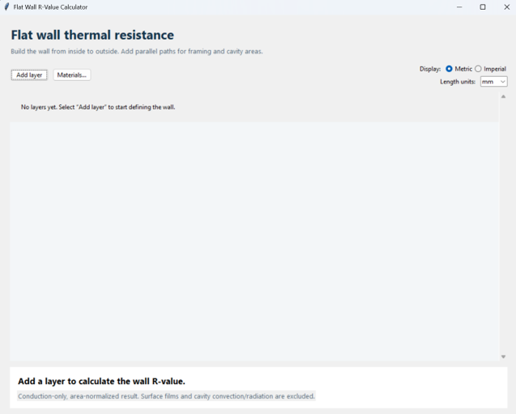
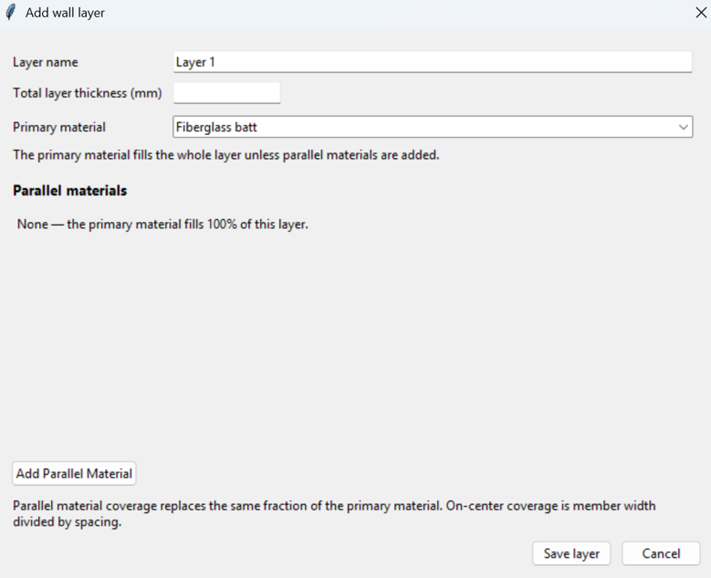
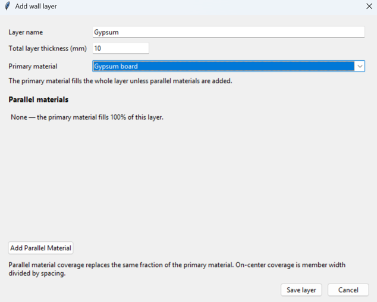
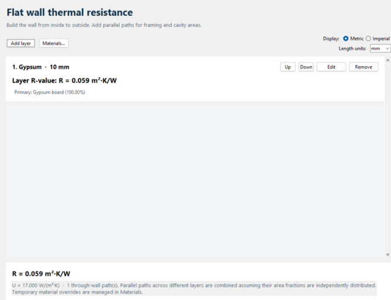
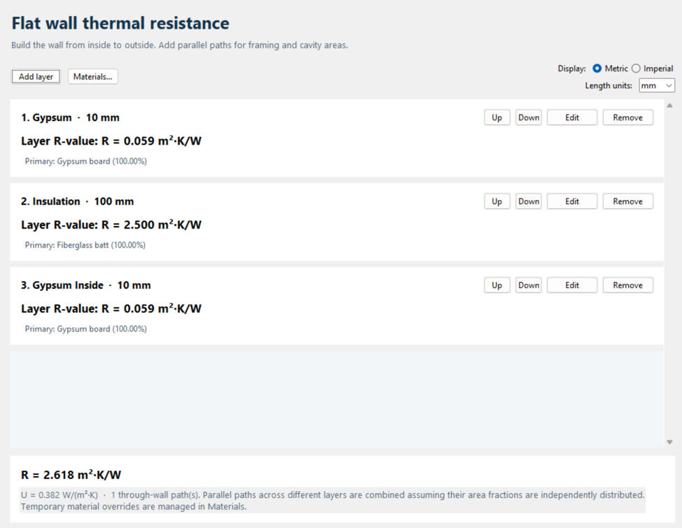
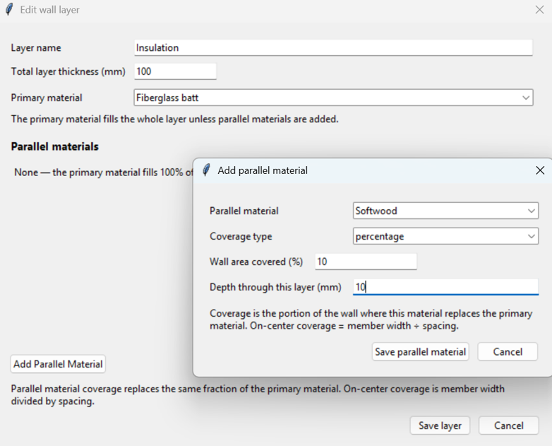
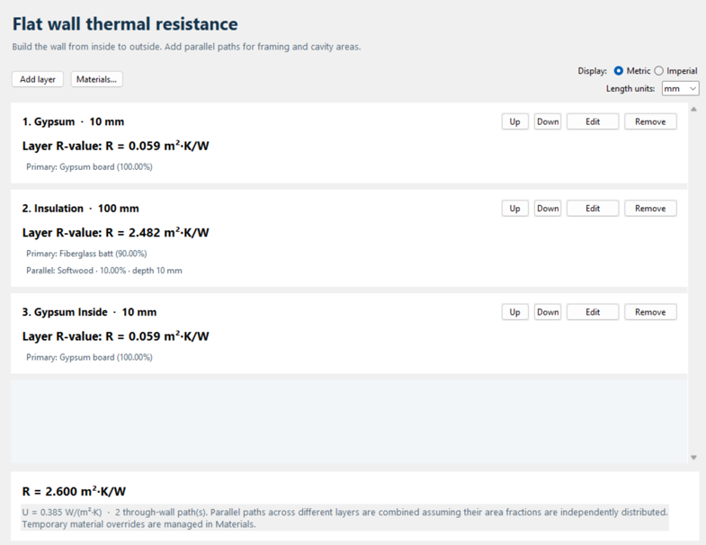
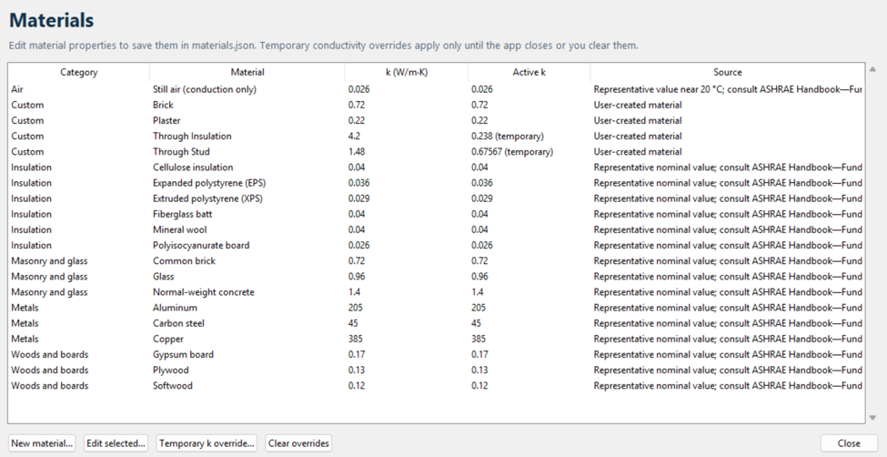

# Flat Wall R-Value Calculator 

A standard-library Python/Tkinter desktop application for estimating the
area-normalized conductive thermal resistance of a flat, layered wall.

## Run

```powershell
python main.py
```

No third-party packages are required. The application stores its built-in and
user-created material properties in `materials.json`.

## Build a wall

1. Select **Metric** or **Imperial** at the top of the app. This controls the
   R-value shown for every layer and for the complete wall. Metric defaults
   length entries to millimeters and displays R in m²·K/W; Imperial defaults
   to inches and displays R in ft²·°F·h/Btu. The length-units dropdown can
   switch among `in`, `mm`, `cm`, and `m`; the radio selection follows the
   chosen length unit.
2. Add wall layers in inside-to-outside order; edit, remove, or move layers as
   needed.
3. Each layer starts with one primary material that fills the entire layer.
   To include framing or another parallel material, select **Add Parallel
   Material**, choose a coverage mode, and enter the material's depth through
   the layer.
4. Percentage coverage directly specifies the fraction of wall area replaced
   by that material. On-center coverage uses both member width and repeating
   on-center spacing:
   `area fraction = member width / on-center spacing`.
   Multiple parallel materials cannot cover more than 100%; the primary
   material automatically occupies the remaining area.

For example, model a 140 mm-deep framed cavity with a 90 mm wood stud by
selecting insulation as the primary material, then adding wood as a parallel
material with 90 mm depth and the appropriate framing coverage (for example,
15%). The insulation remains as the primary material over the uncovered area
and in the remaining 50 mm of the stud path.

## Calculation

For a plane wall, the conduction resistance of a uniform segment is
`R_th = thickness / (k · area)`; multiplying by wall area gives the
area-normalized resistance. For each path through a layer, the app sums each
segment's thickness divided by its conductivity:

`R_path = sum(thickness_i / k_i)` in m²·K/W.

For the full wall, the app forms the possible paths through the series layers
and combines them in parallel using their area fractions:

`1 / R_wall = sum(area_fraction_path / R_path)`.

The reported US R-value uses `1 m²·K/W = 5.678263 ft²·°F·h/Btu`. The result is
area-normalized; a wall's physical area is not required for this calculation.
The displayed order documents the wall assembly, although reordering ideal
series layers does not change the result.

If different layers have parallel materials, their area fractions are assumed
to be independently distributed between layers. Framing that is aligned
through multiple layers can have a different result; this simplified model
does not track geometric alignment between layers.

## Materials and scope

The bundled `materials.json` groups representative conductivity values by
material type. ASHRAE Handbook—Fundamentals, Chapter 26 is the recommended
primary reference for selecting material properties; the preloaded values are
nominal starter estimates, not direct reproductions of its licensed tables.
Actual conductivity varies with grade, density, moisture, temperature, and
product. Check the applicable ASHRAE data and manufacturer specifications for
design work. Public common-material values can also be compared with
[Engineering ToolBox's conductivity table](https://www.engineeringtoolbox.com/thermal-conductivity-d_429.html).

The calculation is conduction-only. It does not include interior/exterior
surface films, cavity convection or radiation, thermal contact resistance,
moisture effects, or temperature-dependent properties. In particular, the
still-air entry represents gas conduction only and is not a complete air-space
R-value. Cylindrical geometries are not supported.

The **Materials** window lists the materials from `materials.json` and lets you
create materials, edit metadata, and apply temporary conductivity overrides.
The saved conductivity (`k`) of an existing material is read-only and is never
changed by editing it in the app. A new material's initial conductivity is
saved when it is created. Temporary overrides are shown separately in the
table, apply only during the current app session, and can be cleared there
without changing saved values.

## References

- [Celsia: Fundamentals of Thermal Resistance](https://celsiainc.com/heat-sink-blog/fundamentals-of-thermal-resistance/) — conduction resistance and series/parallel thermal-network context.
- [ASHRAE Handbook](https://www.ashrae.org/technical-resources/ashrae-handbook) — primary reference for thermal material property data (Fundamentals, Chapter 26).
- [Engineering ToolBox: Thermal Conductivity of Common Materials](https://www.engineeringtoolbox.com/thermal-conductivity-d_429.html) — public cross-reference for representative conductivities.

## Wall Resistance Calculator


## Add Layer






## Add New Layers


## Adding Materials in Parallel




## Materials List
